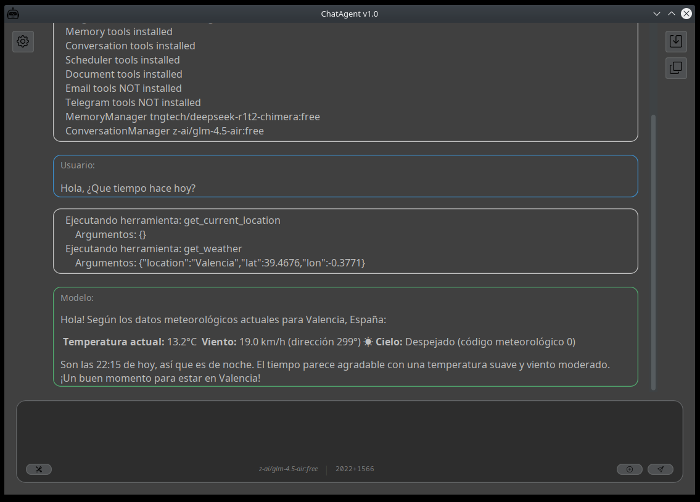

# Noema: laboratorio de arquitectura para agentes de IA

> ⚠️ **Estado del Proyecto: Prototipo de Investigación**
>
> Este repositorio contiene el código fuente que acompaña a mi serie de artículos sobre *Arquitectura de Agentes y Memoria Híbrida*.
>
> **No es un producto de consumo final.** Es una **Prueba de Concepto (PoC)** funcional diseñada para validar arquitecturas de IA locales, proactividad y gestión de memoria a largo plazo. Úsalo para estudiar la arquitectura, extraer patrones o como base para experimentos.
> **¿Problemas al compilar o ejecutar?** Dame un toque y lo vemos. El estado del código cambia rápido y puede que haya algo roto que no haya detectado o haya dejado aparcado. Puedo tener cosas sin commitar o sin subir. Si te interesa el proyecto, me alegrará ayudarte a que funcione.


## Propósito del proyecto

El objetivo de este software es demostrar que es posible construir un Agente Autónomo con persistencia real y capacidad de agencia sin depender de infraestructuras complejas en la nube o frameworks pesados.

Implementa los conceptos teóricos de:

*   **Memoria híbrida determinista:** Separación de roles entre un servicio de razonamiento
    y otro para la consolidación narrativa.
*   **Proactividad simulada:** Implementación del patrón de inyección de eventos simulada 
    y gestión de eventos a través del servicio de sensores para permitir al agente reaccionar a
    estímulos externos dentro del ciclo síncrono del LLM.
*   **Independencia:** Ejecución local con soporte para LLMs remotos o locales.

## Interfaz de usuario

Noema no solo procesa texto; interactúa con su entorno. 



En la captura se puede ver cómo el agente, ante una consulta meteorológica, 
decide de forma autónoma localizar al usuario y consultar una API de clima externa antes de responder.

*   **Razonamiento y Herramientas:** Visualización clara de la ejecución de las herramientas.
*   **Diseño Moderno:** Interfaz con la estética de los asistentes de IA actuales con soporte para Markdown.
*   **Control de Contexto:** Monitorización en tiempo real de los tokens utilizados (Herramientas + Conversación).

## Stack tecnológico

La implementación prioriza la ligereza y el control explícito de recursos:

*   **Core:** Java
*   **Orquestación:** LangChain4j (sin integraciones de alto nivel, solo la interacción con los modelos).
*   **Persistencia:** H2 Database embebida (Modo mixto: Relacional + BLOBs para vectores).
*   **Arquitectura:** Diseño modular basado en *Service Locator* e inyección manual. Sin Spring Boot ni frameworks de DI.
*   **UI:** Escritorio (Swing), Web, TUI y Consola (JLine 3, aunque este lo he tenido abandonado últimamente).

## Documentación y arquitectura

Para una descripción técnica del proyecto, qué es, cómo está construido o qué mecanismos implementa, puedes consultar **[OVERVIEW](./OVERVIEW.md)**.

Para conocer el estado de desarrollo actual y la deuda técnica identificada, consulta **[DEVELOPMENT_STATUS](./DEVELOPMENT_STATUS.md)**.

📄 **Otra documentación relevante**

Puedes encontrar interesantes algunos de los artículos que he publicado y para 
los que este proyecto ha sido el patio de pruebas.

*   [Noema: cuando el patio de juegos no viene de serie](https://jjdelcerro.github.io/es/blog/noema-cuando-el-patio-de-juegos-no-viene-de-serie/)
*   [¿Qué es un agente?](https://jjdelcerro.github.io/es/blog/que-es-un-agente/)
*   [Agentes de IA y la inyección de observaciones proactivas en clientes de chat](https://jjdelcerro.github.io/es/blog/agentes-de-ia-y-la-inyeccion-de-observaciones-proactivas-en-clientes-de-chat/)
*   [Control proactivo de la percepción en agentes de IA](https://jjdelcerro.github.io/es/blog/como-gestionar-la-observacion-proactiva/)
*   [¿Memoria narrativa o resumen para un LLM?](https://jjdelcerro.github.io/es/blog/memoria-narrativa-o-resumen-para-un-llm/)
*   [Diseñando memoria narrativa trazable para agentes conversacionales](https://jjdelcerro.github.io/es/blog/disenando-memoria-narrativa-trazable-para-agentes-conversacionales/)

Si quieres acceder a todos los artículos que he ido publicando los puedes encontrar [aquí](https://jjdelcerro.github.io).

## Características principales

1.  **Gestión de Memoria:** pensada para funcionar a largo plazo, un agente puede funcionar durante semanas manteniendo una interacción coherente con el usuario.

2.  **Herramientas:**
    *   Sistema de archivos (Lectura, escritura, parches...). Las herramientas de lectura funcionan.
    *   Navegación Web (Búsqueda y extracción con Apache Tika). El acceso a documentos en la web, y acceso a algunas APIs como la consulta de la ubicación y el tiempo, están funcionando; pero la búsqueda no.
    *   Comunicación (Cliente de Email IMAP/SMTP, Bot de Telegram). Esta parte está "dejada caer" sin más. Una prueba para ver cómo se podría abordar, pero no está funcional, y en estos momentos no está entre mis prioridades.
    *   Planificador de tareas (Scheduler en lenguaje natural).


## Inicio rápido

### Requisitos
*   JDK 21 o superior.
*   Maven 3.8+.

### Construcción
El proyecto utiliza `maven-shade-plugin` para gestionar las dependencias y los 
SPIs de LangChain4j/Tika.

```bash
mvn clean package
```

### Arranque

El repositorio incluye un script `noema` que resuelve el JAR y añade los 
flags de la JVM necesarios para el motor de embeddings. Úsalo como punto de 
entrada:

```bash
./noema
```

Si necesitas lanzar el JAR directamente, consulta los flags que aplica el 
script; son obligatorios en función de la versión de Java instalada.

### Configuración

El agente necesita configurar los proveedores de LLM. Al arrancar la aplicación
presenta un diálogo de inicio, que permite seleccionar la carpeta de trabajo, y 
nos muestra la configuración actual para los modelos básicos que precisa
para funcionar. Desde ahí mismo puede accederse al diálogo de configuración para
editar la lista de proveedores, modelos o API-KEYS y configurar éstos en la 
aplicación. Aunque permite la configuración en el arranque, no esperes un asistente
de "siguiente->siguiente". Requiere que tengas conocimientos mínimos sobre qué es 
un LLM, qué son herramientas y cómo configurar el acceso a ellos.


1.  Ejecuta el script `noema`.
2.  Accede a la configuración, configura el proveedor, API-Keys y modelos y selecciona
    los que vayas a usar en cada parte de la aplicación.
3.  Una vez realizada la configuración cierra el diálogo de configuración para
    volver a la ventana de inicio y pulsa en continuar.

### Modos de ejecución

Por defecto, la aplicación arranca con la interfaz gráfica (Swing). Una vez 
configurados los proveedores de LLM desde el diálogo inicial, esa configuración 
persiste en el espacio de trabajo y puedes lanzar el agente en otros modos 
mediante argumentos de línea de comandos:

*   `--web`: levanta el servidor web embebido. El navegador no se abre 
    automáticamente; accede manualmente a la URL que se muestra al arrancar.
*   `--console`: consola interactiva basada en JLine.
*   `--tui`: interfaz de terminal basada en Lanterna.

Cada modo es una ejecución independiente del agente. El modo elegido determina qué interfaz se levanta; no conviven entre sí.

## Desarrollo y depuración

Dado que este es un proyecto de investigación, es muy probable que quieras 
inspeccionar el estado interno del agente (por ejemplo, el contenido de la 
memoria episódica o los vectores) mientras se ejecuta.

El repositorio incluye un script `noema` que lanza la aplicación 
exponiendo el puerto JDWP en el `8765`. Una vez iniciada, puedes conectar 
tu depurador a ese puerto para inspeccionar el estado en caliente.

Si necesitas depurar el arranque (por ejemplo, para analizar la inicialización 
de los servicios), lanza el script con el argumento `--debug`. El proceso 
quedará suspendido hasta que te conectes desde el entorno de depuración.
    
## Estructura de datos y personalización

La aplicación crea en la carpeta de trabajo seleccionada una carpeta `.noema-agent`
en la que podemos encontrar la siguiente estructura:

* **home** (usada como home cuando se usa firejail para ejecutar comandos de shell).
* **var**

  * **cache**, carpeta donde guarda la caché de documentos que procesa, por ejemplo,
    datos de texto extraídos de pdf.
  * **config**, aquí está la configuración del agente, en el fichero "settings.json",
    así como los prompts que utiliza en algunas de las tareas que realiza. Pueden
    editarse esos prompts en caliente para experimentar con ellos.
  * **identity**, aquí están los ficheros que conforman la identidad del agente.

    * **core**, estos se cargan automáticamente en el prompt del sistema.
    * **environ**, de estos solo se carga un índice para que el agente pueda cargarlos
      completos cuando los necesite.

  * **lib**, aquí se guardan las bases de datos de memoria y servicios del agente, 
    así como la configuración de sensores y la memoria *viva* de la sesión.
  * **log**, pues eso, los logs de la aplicación.
  * **skills**, aquí se guardan los skills que tiene el agente a su disposición.
  * **tmp**, aquí van a parar los ficheros temporales que genera el agente.


### 1. La base de conocimiento

*   **`var/lib/memory.mv.db`**: Base de Datos H2 embebida. Contiene la tabla de 
    turnos inmutables, metadatos y los embeddings vectoriales. 

### 2. Memoria narrativa 

*   **`var/lib/consolidatememory/consolidatememory-XXX-XXX-XXX.md`**: Estos son los archivos generados por el proceso de consolidación de la memoria.
    Leer estos archivos es la mejor forma de validar cómo el agente consolida la 
    historia sin perder el contexto cognitivo.

### 3. Los prompts

*   **`var/config/prompts/*.md`**: Al primer arranque, el agente despliega los 
    prompts del sistema desde el JAR a esta carpeta. 
    >
    > Puedes editar estos archivos en caliente para ajustar el comportamiento 
    > del agente sin necesidad de volver a compilar el código.
    >

### 4. Estado y configuración

*   **`var/config/settings.json`**: Parámetros de conexión a los proveedores de LLM.
*   **`var/lib/recent_memory-XXX.json`**: Un snapshot memento de la memoria reciente 
    para permitir la recuperación ante cierres inesperados.

### 5. Inspección de datos en vivo

Para facilitar la auditoría de la memoria del agente, la aplicación inicia 
automáticamente un servidor web de H2. En el diálogo de configuración
hay posibilidad de configurar el puerto de este servicio así como un botón
para iniciar la herramienta en el navegador.

Desde aquí puedes ejecutar consultas SQL para observar el estado en tiempo real.

### 6. Estado

Me he centrado en tratar de tener funcionando la parte de:

* Conversación
* Consolidación de memoria
* La gestión básica de sensores
* La gestión de identidad
* La gestión básica de habilidades (skills)
* Que las opciones de configuración sean mínimamente funcionales.
* Gestión básica de la seguridad.
* Herramientas básicas de acceso disco
* Herramientas básicas de acceso a internet (recuperación y búsqueda de contenidos usando [tavily](https://www.tavily.com/pricing))
* Herramientas básicas de control de versiones.
* Ejecución de comandos de shell, aún falta probar la parte de firejail.

Hay muchas cosas que no están funcionales:

* Correo.
* Telegram.
* Muchas opciones de configuración, para asistir en la adición de archivos de 
  identidad, habilidades, configuración en el home del usuario, limpieza de 
  temporales...

Estas partes las iré abordando poco a poco dependiendo de mi disponibilidad de
tiempo.


---
*Desarrollado por [Joaquin del Cerro](https://github.com/jjdelcerro) como parte de la investigación sobre arquitecturas de IA.*


